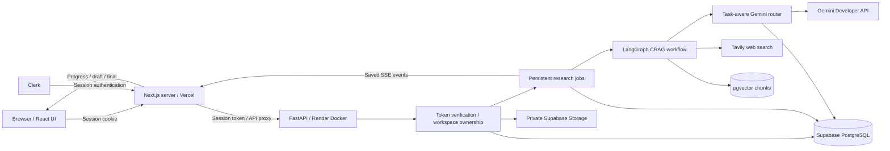
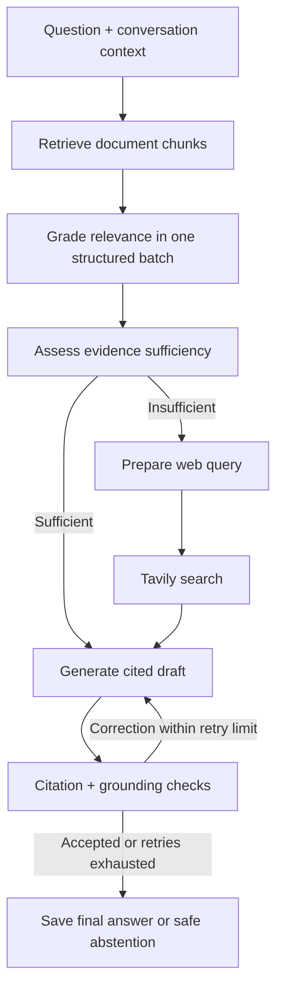

# Crebry — AI Research Workspace

Crebry turns uploaded documents and web evidence into cited research answers. Its corrective retrieval-augmented generation (CRAG) workflow retrieves passages, grades relevance, checks evidence coverage, searches the web when needed, and validates the answer before saving it.

Built with **Next.js, FastAPI, LangGraph, Gemini, Tavily, Clerk, and Supabase**. SQLite and Chroma remain available for local development.

## Features

- Account-owned workspaces, document libraries, saved conversations, and research traces.
- PDF, DOCX, TXT, and Markdown ingestion; scanned PDF OCR; duplicate detection; preview, original download, and staged reindexing.
- Semantic retrieval with a configurable relevance threshold and batched chunk grading.
- Conditional Tavily web search when documents lack sufficient evidence.
- Streamed Markdown drafts, clickable document/web citations, source inspection, copy, and latest-question regeneration.
- Citation membership checks and semantic grounding validation before publication.
- Verified free-tier Gemini routing with task-specific health, cooldowns, bounded retries, quota reservations, and persistent conversation preferences.
- Checkpointed research jobs, saved progress events, explicit retry, cancellation, and browser reconnection.
- Responsive desktop/mobile UI with light/dark themes and clear provider diagnostics.

## Architecture



The browser calls the same-origin `/api/backend` proxy. Next.js forwards a Clerk session token; FastAPI verifies the identity and checks ownership before accessing workspace resources. Gemini, Tavily, and Supabase backend credentials remain on the server.

### Research workflow



Only accepted document chunks and returned web evidence reach generation. `D` citation IDs represent uploaded documents; `W` IDs represent web sources. Standalone topic changes can search the original question without an extra rewrite call. Drafts are provisional, and correction drafts do not clear the visible answer while validation runs.

Completed nodes are checkpointed. Reconnection reads saved events rather than creating a second question. A crash can repeat the in-flight node; a provider stream cannot resume at its exact interrupted token.

### Persistence

| Data | Supabase mode | Local mode |
|---|---|---|
| Workspaces, chats, jobs, routing state | PostgreSQL, private `crebry` schema | SQLite |
| Document chunks and embeddings | pgvector, 768-dimensional Gemini embeddings | Chroma with Gemini or optional local embeddings |
| Original documents | Private Supabase Storage | Local files or optional R2 adapter |
| Upload processing | Temporary backend scratch space | Local data directory |

Render's ephemeral container filesystem is not durable user storage. A new database starts empty; changing provider settings does not migrate existing data.

## Technology stack

<p align="center">
  
</p>

<p align="center">
  
  
  
  
  
</p>

<p align="center">
  
  
  
  
  
</p>

| Layer | Tools | Purpose |
|---|---|---|
| Frontend | Next.js, React, TypeScript | Research UI, server rendering, authenticated API proxy |
| UI state/rendering | Zustand, React Markdown, Radix UI, Framer Motion, React Flow | Session state, citations, dialogs, motion, workflow inspection |
| Backend | FastAPI, Pydantic, Uvicorn | Validated API requests, authentication dependencies, HTTP/SSE |
| AI orchestration | LangGraph, LangChain Google GenAI | Conditional CRAG execution and Gemini integration |
| AI/search | Gemini Developer API, Tavily | Generation, judgments, embeddings/OCR, web evidence |
| Identity | Clerk | User sessions and token verification |
| Persistence | SQLAlchemy, psycopg, PostgreSQL/pgvector, Supabase Storage | Metadata, jobs, vectors, originals |
| Local alternatives | SQLite, Chroma, optional Sentence Transformers/PyTorch | Local storage and CPU embeddings |
| Document processing | PyMuPDF, python-docx, LangChain text splitters | Extraction, page rendering, text chunking |
| Delivery/verification | Docker, uv, Render, Vercel, pytest, Ruff, Vitest, ESLint | Reproducible dependencies, hosting, regression checks |


## Local setup

Prerequisites: **Python 3.12**, **Node.js 24**, npm, and uv. Use the same Clerk application for both services. Gemini is required for answer generation; Tavily enables web fallback.

### Backend

From the repository root:

```powershell
cd backend
uv sync --frozen
```

Create `backend/.env` with local settings. The checked-in backend template describes hosted Supabase mode; do not copy its production settings unchanged for SQLite development.

```dotenv
ENVIRONMENT=development
GEMINI_API_KEY=your_gemini_key
TAVILY_API_KEY=your_tavily_key
EMBEDDING_PROVIDER=gemini
VECTOR_PROVIDER=chroma
STORAGE_PROVIDER=auto
DATA_DIR=data
CLERK_SECRET_KEY=your_clerk_secret_key
CLERK_ISSUER=https://your-clerk-instance-domain
FRONTEND_ORIGIN=http://localhost:3000
CLERK_AUTHORIZED_PARTIES=http://localhost:3000,http://127.0.0.1:3000
```

Leave `DATABASE_URL` unset for SQLite. `CLERK_ISSUER` is the Clerk token issuer, not the frontend URL. Process environment overrides dotenv files.

```powershell
uv run uvicorn app.main:app --host 127.0.0.1 --port 8000
```

Optional CPU embeddings require `uv sync --frozen --extra local` and `EMBEDDING_PROVIDER=local`. The Docker production profile excludes that extra. Retain existing indexes and reindex deliberately when changing embedding providers.

### Frontend

In another terminal, from the repository root:

```powershell
cd frontend
npm ci
if (-not (Test-Path .env.local)) { Copy-Item .env.example .env.local }
```

Configure `frontend/.env.local`:

```dotenv
NEXT_PUBLIC_CLERK_PUBLISHABLE_KEY=your_clerk_publishable_key
CLERK_SECRET_KEY=your_clerk_secret_key
BACKEND_API_URL=http://127.0.0.1:8000/api
```

```powershell
npm run dev
```

Open [localhost:3000](http://localhost:3000), sign in, create a workspace, and upload `examples/research-notes.md`. Ask a document question, then an unrelated question to exercise web fallback. Restart services after changing environment variables.

### Docker

```powershell
docker compose -f docker.yml up --build backend
```

The backend Dockerfile uses a multi-stage slim Python build, frozen `uv.lock`, non-root execution, health checks, and dependency layer caching. Gemini embeddings are the default. The named volume preserves local container data; retain it during troubleshooting.

The optional frontend profile uses `frontend/Dockerfile`. Supply the Clerk publishable key through Compose interpolation at build time and frontend server credentials at runtime:

```powershell
docker compose -f docker.yml --profile frontend up --build
```

## Deployment

| Service | Settings |
|---|---|
| Render backend | Root directory `backend`; Dockerfile `Dockerfile`; build context `.`; health check `/api/health`; default Docker command |
| Vercel frontend | Root directory `frontend`; Next.js framework; Clerk variables and `BACKEND_API_URL=https://your-render-service/api` |
| Supabase | Run `backend/supabase/setup.sql`; configure PostgreSQL session pooler, private Storage, and Gemini embeddings |

The Render paths above are relative to the configured `backend` root. If using the repository root instead, use `backend/Dockerfile` and build context `backend`. Render runs the Dockerfile, not `docker.yml`.

Follow [Supabase deployment configuration](docs/supabase-deployment.md) for the complete environment, pooler URL formatting, private bucket setup, upload limits, and storage preservation. `render.yaml` describes the Docker service; it does not provision Supabase or credentials. This SQLAlchemy backend consumes `DATABASE_URL`, not `DIRECT_URL`.

## Reliability and security

- Identity comes from verified Clerk sessions, never a browser-supplied user ID. Backend checks enforce workspace ownership and child-resource membership.
- Shared routing state records task-specific failures, latency, cooldowns, quota reservations, and last-successful conversation preferences. Distinct eligible models are considered before bounded retries, within operation/research deadlines.
- Manual selection and automatic fallback are separate controls; actual model use is visible. Excluded Gemini 3.6/3.8 Flash families cannot re-enter through cached plans.
- Published free pricing does not disable billing. Use a Google project with billing disabled and confirm that configuration before production startup. Internal budgets must reflect actual project limits; key replacement does not reset quota.
- Citation checks confirm source membership; semantic validation reduces unsupported claims but cannot guarantee factual accuracy. Source instructions remain untrusted. Raw Markdown HTML and generated image tags are not rendered.
- Request budgets, bounded job/model concurrency, idempotency keys, leases, and checkpoints limit duplicate work and provider load.
- Supabase mode refuses silent local fallback for user data. Original files remain private; only scratch space may be temporary.

Back up storage before migration or ownership recovery. Legacy unowned workspaces require explicit verified assignment. See [the reliability report](docs/reliability-report.md) for recovery and rollback guidance.

## Verification

```powershell
# From backend
uv run pytest -q --basetemp=.test-tmp-check
uv run ruff check app tests scripts

# From frontend
npm test
npm run lint
npm run typecheck
npm run build
```

Coverage includes fallback/exhaustion, ownership, retrieval, grounding, job recovery, storage adapters, and frontend stream behavior. Most provider tests use mocks. Local checks do not prove hosted credentials, live provider availability, or real cross-device synchronization. See [verification notes](VERIFICATION.md) and [the reliability report](docs/reliability-report.md) for previous evidence.

## Limitations

- Response time varies with provider queues, quotas, web search, validation, and hosting startup. No fixed latency guarantee is claimed.
- pgvector currently uses exact cosine search; large datasets need measured indexing improvements.
- Replay may repeat an interrupted node. Provider streams cannot resume mid-token; event retention and backup policies require operator planning.
- SQLite and embedded Chroma suit a persistent local service. Multi-instance upload/reindex mutations need additional coordination before unrestricted horizontal scaling.
- Cross-device access requires the same Clerk identity/application and shared durable storage. Browser preferences do not own workspace data.
- Free hosting/storage has capacity limits and may sleep or pause; verify current provider limits and maintain backups.
- Clerk account deletion does not automatically erase stored research data; a deliberate lifecycle policy remains future work.

## Future improvements

Performance changes should preserve the existing retrieve → grade → assess → search → generate → validate flow:

1. **Measure bottlenecks:** record per-node latency, first-token time, total time, retry frequency, and provider error rates.
2. **Reuse connections and clients:** pool HTTP/model clients with credential-aware invalidation and safe shutdown.
3. **Cache repeated retrieval and grading:** key results by user/workspace, document index version, question/context, model, and settings; invalidate when those inputs change.
4. **Tune task budgets:** evaluate concise prompts and smaller output/thinking budgets against retrieval and grounding quality. Structured judgments already have a smaller output cap.
5. **Refine model selection:** use measured latency and existing health state while retaining capability checks, shared quotas, manual selection, and free-only eligibility.
6. **Parallelize independent work:** retain ordering where authorization, evidence, or validation depends on an earlier result.
7. **Strengthen operations:** add measured approximate vector indexing, bounded event retention, monitored backups, and shared upload/reindex coordination.
8. **Expand evaluation:** add hosted cross-device/mobile recovery checks, account-deletion handling, and a repeatable research-quality benchmark.

These are planned improvements, not claimed speed gains. Citations, grounding validation, saved progress, and per-user isolation remain mandatory.

## Repository map

```text
backend/
  app/api/          HTTP endpoints and request models
  app/agents/       LangGraph state, nodes, and routing
  app/core/         Config, auth, readiness, memory, rate limits
  app/models/       SQLAlchemy persistence models
  app/services/     Gemini routing, jobs, documents, vectors, storage
  scripts/          Explicit recovery and smoke-check tools
  supabase/         Hosted database/vector/storage setup SQL
  tests/            Backend regressions
  Dockerfile        Backend production image
  pyproject.toml    Dependency definitions
  uv.lock           Reproducible dependency resolution
frontend/
  app/              Pages, API proxy, layouts, styles
  components/       Research, documents, evidence, workspaces, UI
  hooks/            Chat controls and draft smoothing
  lib/              API/SSE lifecycle, policies, formatting, workflow data
  stores/           Session-scoped Zustand state
  types/            Frontend data contracts
docs/               Deployment and reliability reports
examples/           Sample research document
docker.yml          Local Docker Compose orchestration
render.yaml         Render Docker service configuration
```
